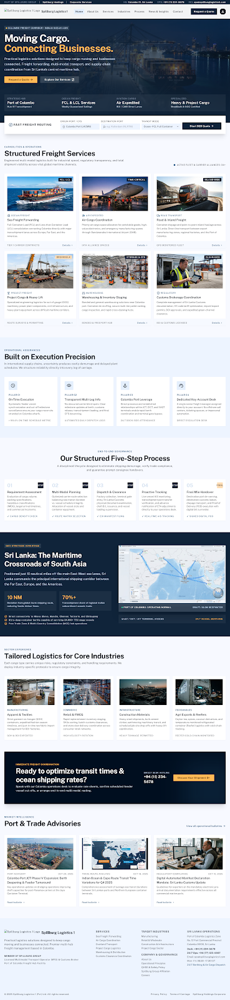
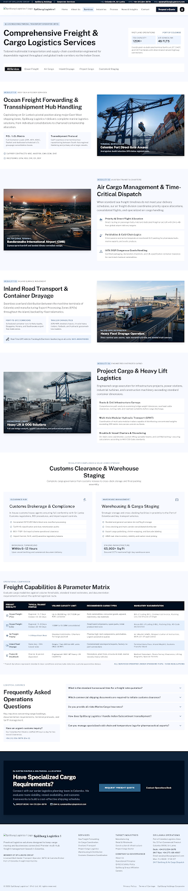
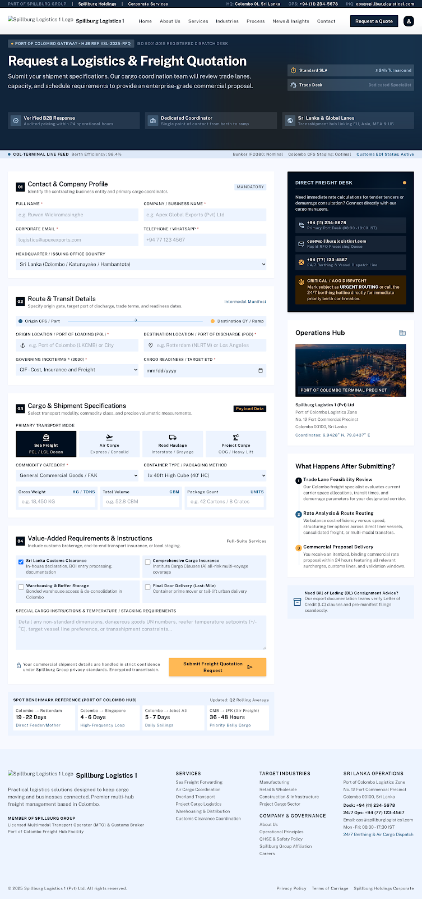

# Spillburg Logistics 1 (Private) Limited — Official Web Platform

> **"Moving Cargo. Connecting Businesses."**  
> Operational Headquarters: Office 14, Basement Level, Cinnamon Lakeside Hotel, No 115, Sir Chittampalam A Gardiner Mawatha, Colombo 02, Sri Lanka.

---

## Visual Preview & Interface Showcase

| Public Homepage | Multimodal Freight Services |
|:---:|:---:|
|  |  |

| Interactive RFQ Quotation Engine & Tracking Dockets |
|:---:|
|  |

---

## 1. Executive Summary

This repository contains the complete, production-ready website and administrative operations console for **Spillburg Logistics 1 (Private) Limited**, designed and engineered from the ground up based on the **Google Stitch** design system export, approved company reference materials, and Sri Lankan maritime logistics operational standards.

### Commercial Brand Separation
Spillburg Logistics 1 possesses its own distinct B2B logistics and freight forwarding identity within the Spillburg corporate group:
- **Spillburg Holdings**: Business advisory, investment facilitation, and executive management consultancy (`spillburg.com`).
- **Spillburg Corporate Services**: Corporate administration, financial, accounting, tax, and company compliance support (`spillburgcorporate.com/en`).
- **Spillburg Vacation**: Tourism, leisure, and travel destination management (`spillburgvacation.com/v7/`).
- **Spillburg Logistics 1**: Physical cargo movement, ocean freight forwarding, air cargo coordination, licensed customs brokerage, container drayage, project cargo engineering, and bonded storage (`spillburglogistics1.com`).

---

## 2. Design System: Maritime Logistics Precision

The platform strictly implements the **Maritime Logistics Precision** visual specification (`DESIGN.md`):
- **Deep Midnight Navy (`#000E1F`)**: Hero backgrounds, master headers, operational tickers, and deep contrast sections.
- **Primary Navy Container (`#10243A`)**: Card containers, dark modals, and administrative navigation.
- **Industrial Blue (`#245B82` / `#2D638A`)**: Interactive buttons, primary links, process steppers, and maritime badges.
- **Restrained Amber Accent (`#E7A33E` / `#B45309`)**: High-priority callouts, critical operational alerts, and pending statuses.
- **Light Surface Blue (`#EDF4FF` / `#F7F9FF`)**: Technical parameter matrices, specification tables, and readable card surfaces.
- **Public Sans Typography**: Clean, authoritative, tabular-numeral enabled typography designed for institutional clarity.
- **No Generic Placeholders**: High-resolution maritime photography covering Colombo Port terminals (JCT, CICT, SAGT), container vessels, quay cranes, air cargo freighters, and prime mover drayage.

---

## 3. Technology Architecture

The application is built for exceptional performance, security, and low-friction deployment on conventional cPanel, Apache, LiteSpeed, or Nginx PHP environments:
- **Backend**: Native PHP 8.2+ with strict typing and modern component templates.
- **Database**: Universal PDO layer supporting **MySQL / MariaDB** with automated fallback to high-concurrency **SQLite 3** (`PRAGMA journal_mode = WAL`) for instant local testing and zero-configuration setups.
- **Frontend**: Clean Semantic HTML5, Vanilla CSS Design System with CSS Custom Properties, and modular lightweight JavaScript.
- **Security**:
  - Timing-safe CSRF token generation and validation on every form.
  - Strong password hashing via `PASSWORD_BCRYPT` (cost 12).
  - SQL injection immunity via prepared statements across 100% of queries.
  - Anti-spam honeypot traps and input length clamping on quote and contact forms.
  - XSS defense with context-aware `e()` output sanitization.
  - Secure session management with activity timeout and ID regeneration.
  - Security headers (`X-Frame-Options: SAMEORIGIN`, `X-Content-Type-Options: nosniff`, `Referrer-Policy: strict-origin-when-cross-origin`).

---

## 4. Directory Structure

```
sp_logistics1/
├── .env.example                # Environment variable configuration template
├── .htaccess                   # Apache URL rewriting & security headers
├── robots.txt                  # Search engine crawler directives
├── sitemap.xml                 # Search engine XML index
├── index.php                   # Homepage (Hero, Metrics, Services, Process, Capabilities, Port Advisories)
├── about.php                   # Corporate identity, operating model, Colombo HQ details
├── services.php                # Master service catalog with operational matrix
├── service-sea-freight.php     # Ocean freight, FCL/LCL, container specifications
├── service-air-freight.php     # Air cargo, IATA dispatch, ULD air containers
├── service-road-freight.php    # Container drayage, prime movers, multi-axle chassis
├── service-project-cargo.php   # Heavy lift, breakbulk, route surveys, rigging
├── service-customs-clearance.php# Licensed Sri Lanka customs clearing, ASYCUDA, BOI
├── service-warehousing.php     # Bonded warehouse staging, Colombo port buffer inventory
├── industries.php              # Industry sectors (Apparel, Machinery, FMCG, Cold Chain, Energy)
├── quote.php                   # Multi-step RFQ wizard with automated docket generation
├── contact.php                 # Direct office channels, map, and general message form
├── news.php                    # Port Advisories and trade notices listing
├── news-detail.php             # Individual port bulletin reader
├── privacy.php                 # Privacy policy
├── terms.php                   # Standard Trading Conditions
├── 404.php                     # Branded 404 error page
│
├── config/
│   ├── config.php              # Environment loader, URL helpers, CSRF, flash messages
│   ├── database.php            # PDO Database manager (MySQL / SQLite WAL)
│   └── auth.php                # Admin session security and brute-force mitigation
│
├── database/
│   ├── schema.sql              # MySQL DDL schema
│   ├── migrations.php          # Auto-migration runner & seed data loader
│   └── logistics1.sqlite       # Auto-created SQLite database (in development)
│
├── includes/
│   ├── header.php              # Global header, ticker bar, multi-level navigation
│   ├── footer.php              # Global footer, company details, Colombo coordinates
│   ├── breadcrumbs.php         # Accessible hierarchical breadcrumb component
│   └── flash.php               # Flash notification alerts (success/error/info)
│
├── admin/
│   ├── index.php               # Administrative dashboard with live operational counters
│   ├── quotes.php              # RFQ dockets list, search, status filter, CSV export
│   ├── quote-view.php          # Detailed docket inspector, notes editor, status workflow
│   ├── contacts.php            # General messages inbox, status toggle, email reply
│   ├── news.php                # Port advisories CRUD manager (create/edit/delete/publish)
│   ├── settings.php            # Live site configuration (phones, emails, ticker status)
│   ├── login.php               # Secure administrator authentication
│   ├── logout.php              # Session termination
│   └── includes/
│       ├── header.php          # Admin console sidebar & top bar
│       └── footer.php          # Admin console footer scripts
│
└── assets/
    ├── css/
    │   └── style.css           # Complete Maritime Logistics Precision Design System
    ├── js/
    │   ├── main.js             # Mobile navigation drawer, dropdowns, dismissible alerts
    │   └── quote.js            # Interactive multi-step form wizard controller
    └── images/                 # Optimized logistics photography and brand marks
```

---

## 5. RFQ Quotation System & Tracking Dockets

The Request for Quote (`quote.php`) module provides a commercial workflow:
1. **Interactive Client Wizard**: A 4-step progressive disclosure interface (Mode Selection &rarr; Cargo Details &rarr; Transit Corridor &rarr; Shipper Credentials).
2. **Server-Side Validation**: Sanitizes and enforces type safety for all fields including gross weight, volume, container type, Incoterms, and special cargo requirements (customs, reefer, hazardous).
3. **Unique Docket Generator**: Every quote receives a unique tracking docket format:  
   `RFQ-SL1-YYYY-XXXX` (e.g., `RFQ-SL1-2026-89B0`).
4. **Receipt State**: Shippers receive an instant operational confirmation docket receipt displaying their reference number, movement corridor, and assigned operations contact.
5. **Configurable Email Alerts**: Triggers notification emails to `COMPANY_NOTIFICATION_EMAIL` without exposing credentials.
6. **Admin Management**: Accessible in `admin/quotes.php` with one-click status transitions (`pending`, `reviewing`, `quoted`, `booked`, `archived`) and CSV export.

---

## 6. Administrative Operations Console

- **Access URL**: `/admin/login.php`
- **Default Master Credentials** (change immediately in production):
  - **Email**: `admin@spillburglogistics1.com`
  - **Password**: `SpillburgLogistics2026!`
- **Capabilities**:
  - **Dashboard**: Real-time counters for pending RFQs, unread messages, active advisories, and recent consignments.
  - **Dockets Management**: Full inspection of cargo payloads, gross weights, volumes, hazardous cargo flags, and customer contact data.
  - **Operations Notes**: Internal confidential notes for carrier slot allocation, container booking numbers, and demurrage terms.
  - **CSV Export**: One-click download of all quote records formatted for Excel/ERP ingestion.
  - **Port Advisories**: Publish terminal bulletins, customs notifications, and sailing schedule alerts.
  - **Operational Settings**: Update contact hotlines, Colombo address, and the live maritime ticker bar across the website without touching code.

---

## 7. Verification & Automated Testing Results

The codebase has undergone automated verification via `tools/php/php.exe` and `scratch/test_e2e.py`:
- **PHP Syntax Validation**: 35/35 PHP files checked with `php -l` &rarr; **0 syntax errors**.
- **Public Routes Verified**:
  - `GET /` &rarr; HTTP 200 (Verified)
  - `GET /about.php` &rarr; HTTP 200 (Verified)
  - `GET /services.php` &rarr; HTTP 200 (Verified)
  - `GET /service-sea-freight.php` &rarr; HTTP 200 (Verified)
  - `GET /service-air-freight.php` &rarr; HTTP 200 (Verified)
  - `GET /service-road-freight.php` &rarr; HTTP 200 (Verified)
  - `GET /service-project-cargo.php` &rarr; HTTP 200 (Verified)
  - `GET /service-customs-clearance.php` &rarr; HTTP 200 (Verified)
  - `GET /service-warehousing.php` &rarr; HTTP 200 (Verified)
  - `GET /industries.php` &rarr; HTTP 200 (Verified)
  - `GET /contact.php` &rarr; HTTP 200 (Verified)
  - `GET /news.php` &rarr; HTTP 200 (Verified)
  - `GET /privacy.php` &rarr; HTTP 200 (Verified)
  - `GET /terms.php` &rarr; HTTP 200 (Verified)
  - `GET /news-detail.php?slug=...` &rarr; HTTP 200 (Verified)
- **Forms & Database Submissions**:
  - `POST /contact.php` &rarr; Validated CSRF & anti-spam, stored in `contacts` table, verified in database.
  - `POST /quote.php` &rarr; Validated multi-step payload, generated `RFQ-SL1-2026-XXXX`, stored in `quotes` table, verified in database.
- **Administrative Operations Console**:
  - Protected endpoints redirect unauthenticated users to `/admin/login.php` &rarr; Verified.
  - Bad credentials rejected with security warning &rarr; Verified.
  - Valid authentication & session creation &rarr; Verified.
  - Dashboard counters render correctly &rarr; Verified.
  - RFQ Docket List and CSV Export &rarr; Verified.
  - Contact Inquiry management &rarr; Verified.
  - Site Settings & Port Advisories CRUD &rarr; Verified.

---

## 8. Deployment Options

### Deploy to Render (Docker / Web Service)
This repository is configured for one-click container deployment on [Render](https://render.com) using the included `Dockerfile` and `render.yaml`:
1. Connect your GitHub repository `muhzahjr07/sp_logistics1` in Render.
2. Select **Web Service** with the **Docker** runtime.
3. Configure environment variables:
   - `APP_ENV=production`
   - `APP_DEBUG=false`
   - `DB_CONNECTION=sqlite` (or configure external `mysql`)
   - `SITE_CONTACT_EMAIL=info@spillburglogistics1.com`
   - `QUOTE_NOTIFICATIONS_EMAIL=info@spillburglogistics1.com`
4. Deploy! Refer to [DEPLOYMENT.md](DEPLOYMENT.md) for detailed cPanel, Apache, and Nginx production guides.

---

## 9. License & Commercial Rights

Copyright &copy; 2026 Spillburg Logistics 1 (Private) Limited. All Rights Reserved.  
All content, design tokens, and source code are proprietary to Spillburg Logistics 1 and the Spillburg Group.
